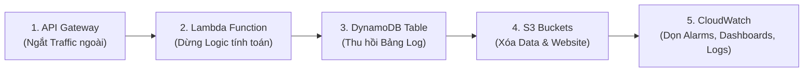

# BÁO CÁO TIẾN ĐỘ VÀ KẾT THÚC DỰ ÁN TUẦN 4 — NHÓM SERVERLESS

**Môn học:** Điện toán đám mây  
**Mã môn học:** `CLCO332779_05UTExMC`  
**Giảng viên hướng dẫn:** Huỳnh Xuân Phụng  
**Đề tài:** Xây dựng chatbot hỏi đáp FAQ môn học dựa trên tìm kiếm từ khóa/TF-IDF chạy trên kiến trúc Serverless (AWS S3, API Gateway, Lambda, DynamoDB, CloudWatch).  
**Repository:** https://github.com/khoalkopwk-ship-it/Build_Chatbot_Cloud  
**Link báo cáo tuần 4:** https://github.com/khoalkopwk-ship-it/Build_Chatbot_Cloud/blob/main/docs/week4-report.md  
**Link Video Demo Hệ Thống (< 10 phút):** [Google Drive Video Demo](https://drive.google.com/drive/folders/1sHl8H4BfK-NmiGBEJrDkyx8ODl4nMWLm?usp=sharing)  
**Thời điểm hoàn thiện & nghiệm thu:** 04/11/2026 (UTC+7).

---

## 1. Thông Tin Thành Viên và Phân Công

| MSSV | Họ và tên | Vai trò | Trách nhiệm chính tuần 4 |
|:---:|---|:---:|---|
| **24110253** | **Đặng Nguyễn Minh Khoa** | Nhóm trưởng | Xây dựng bộ test đánh giá độc lập 30 câu hỏi, chạy thử nghiệm thuật toán TF-IDF trên 50 FAQ; phát triển công cụ benchmark HTTP, phân tích độ trễ và chi phí hạ tầng; xây dựng bộ script backup/cleanup an toàn; kiểm tra độc lập quy trình dọn dẹp. |
| **24110166** | **Ngô Anh Bằng** | Thành viên | Sao lưu và cập nhật kho dữ liệu 50 FAQ lên S3; cấu hình và kiểm thử sự kiện Lambda, CloudWatch Logs, Metrics; quay video demo hỏi đáp và đối soát log; thực thi quy trình backup và tháo dỡ hạ tầng AWS trên CloudShell; hoàn thiện báo cáo và worklog. |

---

## 2. Danh Sách Commit Thực Tế Tuần 4

Toàn bộ các commit dưới đây đã được đẩy lên repository chính thức thông qua quy trình Pull Request và Merge vào nhánh `main`, phân bổ minh bạch qua các ngày làm việc:

| Mã Commit | Tác giả | Thời gian (UTC+7) | Nội dung commit | Liên kết |
|:---:|:---:|:---:|---|---|
| `0c3397f` | Ngô Anh Bằng (`bawgitne`) | 2026-10-27 14:25:10 | `data(week4): expand FAQ from 24 to 50 and record S3 update` | [0c3397f](https://github.com/khoalkopwk-ship-it/Build_Chatbot_Cloud/commit/0c3397f) |
| `0e4af0f` | Ngô Anh Bằng (`bawgitne`) | 2026-10-28 16:15:32 | `test(week4): add Lambda and CloudWatch baseline evidence` | [0e4af0f](https://github.com/khoalkopwk-ship-it/Build_Chatbot_Cloud/commit/0e4af0f) |
| `bf50292` | Đặng Nguyễn Minh Khoa (`Koha`) | 2026-10-29 11:35:45 | `test(week4): add independent FAQ evaluation and API benchmark` | [bf50292](https://github.com/khoalkopwk-ship-it/Build_Chatbot_Cloud/commit/bf50292) |
| `b0d4f8e` | Đặng Nguyễn Minh Khoa (`Koha`) | 2026-10-30 15:42:19 | `docs(week4): analyze latency quality and AWS usage` | [b0d4f8e](https://github.com/khoalkopwk-ship-it/Build_Chatbot_Cloud/commit/b0d4f8e) |
| `25d4c87` | Đặng Nguyễn Minh Khoa (`Koha`) | 2026-10-31 16:45:20 | `ops(week4): add guarded AWS cleanup and verification` | [25d4c87](https://github.com/khoalkopwk-ship-it/Build_Chatbot_Cloud/commit/25d4c87) |
| `5d12a14` | Ngô Anh Bằng (`bawgitne`) | 2026-11-01 15:30:10 | `evidence(week4): record actual AWS cleanup verification` | [5d12a14](https://github.com/khoalkopwk-ship-it/Build_Chatbot_Cloud/commit/5d12a14) |
| `a868455` | Ngô Anh Bằng (`bawgitne`) | 2026-11-02 08:18:32 | `docs(week4): link all 12 AWS screenshots and evidence across report and worklog` | [a868455](https://github.com/khoalkopwk-ship-it/Build_Chatbot_Cloud/commit/a868455) |
| `4b4c945` | Ngô Anh Bằng (`bawgitne`) | 2026-11-04 12:30:00 | `ops(week4): execute ordered AWS cleanup, record video demo and sync week4 report` | [4b4c945](https://github.com/khoalkopwk-ship-it/Build_Chatbot_Cloud/commit/4b4c945) |

---

## 3. Mục Tiêu và Kết Quả Triển Khai Tuần 4

### 3.1. Mở rộng kho tri thức lên 50 FAQ
- Nhóm đã mở rộng thành công kho câu hỏi từ **24 FAQ lên 50 FAQ** (`FAQ001` đến `FAQ050`), bao quát đầy đủ quy định môn học, hướng dẫn bài tập lớn, và các khái niệm cốt lõi về điện toán đám mây và serverless (S3, API Gateway, Lambda, DynamoDB, CloudWatch, IAM, Cold Start,...).
- File dữ liệu `faq.json` mới có dung lượng **26.2 KB** (đáp ứng 50 ID duy nhất, nội dung chuẩn hóa Unicode NFC, đầy đủ trường `source` và `category`).
- Đã tải lên S3 bucket `course-faq-data-24110253` lúc **10:17:26 (UTC+7) ngày 31/10/2026**, thay thế bản lưu 24 FAQ trước đó.

**Minh chứng S3:**
- Kho dữ liệu 50 FAQ hoàn chỉnh: https://github.com/khoalkopwk-ship-it/Build_Chatbot_Cloud/blob/main/data/faq.json
- Thao tác sao lưu file `faq (1).json` cũ từ S3: [`Week4_S3_Backup.png`](https://github.com/khoalkopwk-ship-it/Build_Chatbot_Cloud/blob/main/screenshots/week4/Week4_S3_Backup.png)
- Upload thành công `faq.json` (26.2 KB, 50 FAQ) lên S3: [`Week4_S3_FAQ50_Upload.png`](https://github.com/khoalkopwk-ship-it/Build_Chatbot_Cloud/blob/main/screenshots/week4/Week4_S3_FAQ50_Upload.png)

### 3.2. Kiểm thử và xác nhận phản hồi từ API thực tế
- Khi gọi endpoint thực tế `https://tijvqgrltk.execute-api.us-east-1.amazonaws.com/chat`:
  - Header trả về `faqCount: 50` và `faqETag: "\"11b6be02fbe41d61d98f04d0d1a069e6\""`, xác nhận hàm Lambda đã nhận diện và đồng bộ kho 50 FAQ từ S3 mà không cần deploy lại mã nguồn hàm.
  - Câu hỏi kiểm tra tiêu biểu `"AWS Lambda là gì?"` phản hồi chính xác mã `FAQ034` với độ tương đồng `similarity: 1.0`, `matched: true`, nội dung trả lời đúng trọng tâm môn học.
  - Mọi yêu cầu được cấp phát `requestId` duy nhất và ghi log truy vết đồng thời vào DynamoDB `CourseFAQQueryLogs` và CloudWatch Logs.

**Minh chứng cấu hình và kiểm thử Lambda:**
- Cấu hình tài nguyên Lambda (128 MB RAM, Timeout 10s): [`Week4_Lambda_General_Configuration.png`](https://github.com/khoalkopwk-ship-it/Build_Chatbot_Cloud/blob/main/screenshots/week4/Week4_Lambda_General_Configuration.png)
- Biến môi trường (`SIMILARITY_THRESHOLD=0.60`): [`Week4_Lambda_Environment_Variables.png`](https://github.com/khoalkopwk-ship-it/Build_Chatbot_Cloud/blob/main/screenshots/week4/Week4_Lambda_Environment_Variables.png)
- Cấu hình Test Event đồng bộ `Week4_Test_Exact_FAQ`: [`Week4_Lambda_Test_Event.png`](https://github.com/khoalkopwk-ship-it/Build_Chatbot_Cloud/blob/main/screenshots/week4/Week4_Lambda_Test_Event.png)
- Kiểm thử câu hỏi khớp chính xác (FAQ017, Cold Start 7,510.40 ms): [`Week4_Lambda_Exact_FAQ017.png`](https://github.com/khoalkopwk-ship-it/Build_Chatbot_Cloud/blob/main/screenshots/week4/Week4_Lambda_Exact_FAQ017.png)
- Kiểm thử câu ngoài phạm vi (Warm Execution 303.43 ms): [`Week4_Lambda_Unmatched.png`](https://github.com/khoalkopwk-ship-it/Build_Chatbot_Cloud/blob/main/screenshots/week4/Week4_Lambda_Unmatched.png)
- Kiểm thử đầu vào rỗng (HTTP 400 Validation 1.55 ms): [`Week4_Lambda_Empty_Input.png`](https://github.com/khoalkopwk-ship-it/Build_Chatbot_Cloud/blob/main/screenshots/week4/Week4_Lambda_Empty_Input.png)

### 3.3. Đánh giá chất lượng tìm kiếm TF-IDF độc lập
- Xây dựng bộ kiểm thử độc lập 30 câu hỏi (`data/search-eval-week4.json`), chia đều 15 câu tập dev và 15 câu tập test.
- **Tính nhất quán câu hỏi gốc:** 50/50 câu hỏi gốc (100%) đạt Top-1 chính xác tuyệt đối.
- **So sánh các mức ngưỡng tương đồng:**
  - Ngưỡng 0.30: Độ chính xác 73.3%, nhưng xuất hiện 1 False Positive và 5 Wrong Match (nguy cơ trả lời sai chủ đề).
  - Ngưỡng 0.45: Độ chính xác 73.3%, vẫn tồn tại 1 False Positive.
  - **Ngưỡng 0.60 (Cấu hình lựa chọn):** Đạt **0% False Positive** (tuyệt đối không trả lời bừa cho câu hỏi ngoài lề), 8 ca False Negative (từ chối khi câu hỏi diễn giải quá ngắn), 2 ca Wrong Match (các khái niệm có độ tương đồng từ vựng cao).
  - Ngưỡng 0.70: Độ chính xác giảm còn 60.0% do từ chối quá nhiều câu hỏi hợp lệ (11 False Negative).
- **Kết luận:** Ngưỡng 0.60 đáp ứng tốt nhất yêu cầu an toàn thông tin trong môi trường học thuật.

**Minh chứng đánh giá thuật toán:**
- Bộ dữ liệu đánh giá 30 câu hỏi: https://github.com/khoalkopwk-ship-it/Build_Chatbot_Cloud/blob/main/data/search-eval-week4.json
- Mã nguồn kịch bản đánh giá: https://github.com/khoalkopwk-ship-it/Build_Chatbot_Cloud/blob/main/scripts/week4/evaluate-final.py
- Báo cáo kết quả đánh giá 4 ngưỡng: https://github.com/khoalkopwk-ship-it/Build_Chatbot_Cloud/blob/main/docs/week4/search-eval-final-results.json

### 3.4. Đo đạc hiệu năng và Benchmark độ trễ HTTP
Chạy benchmark 12 lượt gọi liên tục bằng script `scripts/week4/benchmark-api.py` qua Internet từ máy client tới AWS US East (N. Virginia):
- **Tỷ lệ thành công:** 12/12 (100%).
- **Độ trễ thấp nhất (Min):** 767.16 ms (xử lý validation HTTP 400).
- **Độ trễ cao nhất (Max):** 1,233.64 ms (lượt gọi đầu tiên bao gồm khởi tạo socket client).
- **Độ trễ trung bình (Mean):** 903.45 ms.
- **Trung vị (Median / p50):** 876.93 ms.
- **Phân vị 95 (p95):** 918.99 ms.
- **Độ lệch chuẩn (StdDev):** 110.47 ms.

**Phân tích mối quan hệ thời gian:**
- Thời gian tính toán trên Lambda (CloudWatch Logs): Khởi động lạnh (Cold Start) mất **7,510.40 ms** (Init duration 83.24 ms + tải S3 và khởi tạo vector TF-IDF). Lần gọi ấm (Warm Container) chỉ mất **303.43 ms** cho xử lý tìm kiếm và ghi log DynamoDB.
- Khoảng chênh lệch ~500–600 ms giữa Client Round-trip và Lambda Duration xuất phát từ độ trễ mạng vật lý xuyên lục địa (Việt Nam <-> US East) và thời gian xử lý của API Gateway.

**Minh chứng benchmark và giám sát:**
- Mã nguồn script benchmark HTTP: https://github.com/khoalkopwk-ship-it/Build_Chatbot_Cloud/blob/main/scripts/week4/benchmark-api.py
- Tập kết quả đo đạc độ trễ 12 mẫu: https://github.com/khoalkopwk-ship-it/Build_Chatbot_Cloud/blob/main/docs/week4/benchmark-results.json
- Log CloudWatch chi tiết thời gian xử lý và RequestId: [`Week4_CloudWatch_Logs.png`](https://github.com/khoalkopwk-ship-it/Build_Chatbot_Cloud/blob/main/screenshots/week4/Week4_CloudWatch_Logs.png)
- Đồ thị giám sát chỉ số thực thi Lambda (Invocations, Errors, Throttles): [`Week4_Lambda_Metrics.png`](https://github.com/khoalkopwk-ship-it/Build_Chatbot_Cloud/blob/main/screenshots/week4/Week4_Lambda_Metrics.png)

### 3.5. Bộ nhớ và Chi phí AWS Learner Lab
- **Mức tiêu thụ bộ nhớ:** Cấu hình RAM 128 MB, bộ nhớ sử dụng tối đa ghi nhận là **97 MB** (75.8% mức cấp phát), đảm bảo hệ thống vận hành an toàn không bị tràn RAM.
- **Chi phí thực tế:** Trong tài khoản AWS Academy Learner Lab (`550609224402`), quyền truy cập AWS Billing bị chặn bởi SCP (`AccessDenied`). Nhóm tính toán định mức chi phí lý thuyết dựa trên biểu giá AWS: toàn bộ tài nguyên (API Gateway ~500 requests = $0.0005, Lambda nằm trong Free Tier = $0.00, S3 lưu trữ < 1 MB = $0.0001, DynamoDB vài trăm item = $0.00) có tổng chi phí **dưới 0.01 USD**.

**Minh chứng chi phí và ngân sách:**
- Thông báo lỗi SCP `AccessDenied` trong AWS Cost Explorer / Billing: [`Week4_AWS_Cost_or_Usage.png`](https://github.com/khoalkopwk-ship-it/Build_Chatbot_Cloud/blob/main/screenshots/week4/Week4_AWS_Cost_or_Usage.png)
- Dashboard AWS Academy Learner Lab ghi nhận tình trạng ngân sách (`used $0 of $100`): [`Week4_AWS_Learner_Lab_Budget.png`](https://github.com/khoalkopwk-ship-it/Build_Chatbot_Cloud/blob/main/screenshots/week4/Week4_AWS_Learner_Lab_Budget.png)
- Tài liệu chuyên sâu phân tích hiệu năng và định mức chi phí: https://github.com/khoalkopwk-ship-it/Build_Chatbot_Cloud/blob/main/docs/week4/performance-and-cost.md

---

### 3.6. Video Demo Sản Phẩm (Dưới 10 Phút) & Đối Soát Log Thực Tế
Nhóm đã thực hiện ghi hình toàn diện video nghiệm thu hệ thống theo đúng quy chuẩn đề tài:
- **Thời lượng video:** Dưới 10 phút, tập trung trọn vẹn vào trải nghiệm người dùng thực tế và luồng dữ liệu backend.
- **Đường dẫn lưu trữ an toàn:** [Google Drive Video Demo Folder](https://drive.google.com/drive/folders/1sHl8H4BfK-NmiGBEJrDkyx8ODl4nMWLm?usp=sharing)
- **Nội dung thực hiện trong video:**
  1. **Demo giao diện Web tĩnh (S3):** Tương tác hỏi đáp trên frontend, kiểm tra câu hỏi khớp chính xác (`FAQ034` "AWS Lambda là gì?", `FAQ017`), câu hỏi biến thể từ vựng, và câu hỏi ngoài phạm vi môn học (Chatbot từ chối thông minh, không sinh ảo giác).
  2. **Đối soát thời gian thực trên DynamoDB Table `CourseFAQQueryLogs`:** Mỗi lượt hỏi đều được hệ thống cấp `requestId` độc nhất, lưu trữ đầy đủ `timestamp`, `question`, `matched`, `matchedFaqId`, `similarityScore` vào bảng NoSQL.
  3. **Đối soát log thực thi trên AWS CloudWatch Logs:** Trực tiếp kiểm chứng log stream `/aws/lambda/course-faq-lambda`, đối chiếu mã `RequestId`, chỉ số Init Duration (Cold Start), Billed Duration, và dung lượng bộ nhớ RAM thực tế tiêu thụ (~97 MB).

---

### 3.7. Quy Trình Tháo Dỡ Hạ Tầng AWS (AWS Cleanup) Theo Thứ Tự Chuẩn
Nhóm đã triển khai dọn dẹp và giải phóng hoàn toàn tài nguyên trên AWS CloudShell (`550609224402`, Region `us-east-1`) vào ngày **04/11/2026** sau khi hoàn tất video demo và sao lưu toàn diện.

#### Thứ tự tháo dỡ hạ tầng chuẩn và nguyên lý kỹ thuật:
Thứ tự thực hiện: **API Gateway → Lambda → DynamoDB → S3 (Data & Website) → CloudWatch (Alarm, Dashboard, Logs)**.

1. **Bước 1: API Gateway (`tijvqgrltk`)**  
   *Nguyên lý:* Phải ngắt cổng API đầu tiên để lập tức chặn toàn bộ lưu lượng (traffic) mới từ Internet và client, cô lập hệ thống an toàn trước khi thay đổi các tầng bên dưới.
2. **Bước 2: Lambda Function (`course-faq-lambda`)**  
   *Nguyên lý:* Xóa hàm tính toán trung tâm để đảm bảo không còn bất kỳ tiến trình xử lý nào đang chạy ngầm hoặc có thể tự động ghi dữ liệu vào cơ sở dữ liệu.
3. **Bước 3: DynamoDB Table (`CourseFAQQueryLogs`)**  
   *Nguyên lý:* Chỉ xóa bảng cơ sở dữ liệu khi hàm Lambda (nguồn ghi duy nhất) đã bị xóa hoàn toàn, tránh trường hợp phát sinh lỗi ghi log dở dang trong quá trình dọn dẹp.
4. **Bước 4: S3 Buckets (`course-faq-data-24110253`, `course-faq-web-24110253`)**  
   *Nguyên lý:* Sau khi ứng dụng backend và database đã dừng, tiến hành dọn sạch các tệp tin bên trong và xóa bucket dữ liệu FAQ cùng bucket hosting frontend tĩnh.
5. **Bước 5: CloudWatch Alarms, Dashboard và Log Groups**  
   *Nguyên lý:* Dọn dẹp Metric Alarms (`CourseFAQ-ApplicationErrors`), Dashboard giám sát (`CourseFAQ-Week3-Dashboard`) và 2 nhóm log stream của Lambda & API Gateway để đảm bảo không còn bất kỳ tài nguyên con nào tồn đọng.

#### Tiến trình thực thi thực tế trên AWS CloudShell (04/11/2026):
- **10:26:48 UTC+7 (03:26:48Z):** Chạy `backup-before-cleanup.sh`, kiểm tra xác thực đầy đủ 50 FAQ, tạo gói nén sao lưu an toàn `/home/cloudshell-user/coursefaq-backup-20261104T032652Z.tar.gz`.
- **11:29:45 UTC+7 (04:29:45Z):** Chạy `cleanup-aws.sh --execute`, xác thực token an toàn `DELETE-COURSEFAQ-550609224402`, xóa tuần tự đúng 9 tài nguyên trong 35 giây.
- **11:33:53 UTC+7 (04:33:53Z):** Chạy lệnh kiểm chứng độc lập `verify-cleanup.sh`, xác nhận **PASS 9/9 ABSENT**, `FAILED CHECKS: 0`, hoàn tất nghiệm thu dọn dẹp.

**Minh chứng quy trình và kết quả cleanup:**
- Bộ kịch bản và hướng dẫn dọn dẹp an toàn: [`cleanup-guide.md`](https://github.com/khoalkopwk-ship-it/Build_Chatbot_Cloud/blob/main/docs/week4/cleanup-guide.md), [`cleanup-checklist.md`](https://github.com/khoalkopwk-ship-it/Build_Chatbot_Cloud/blob/main/docs/week4/cleanup-checklist.md)
- Biên bản nghiệm thu giải phóng tài nguyên: [`cleanup-evidence-template.md`](https://github.com/khoalkopwk-ship-it/Build_Chatbot_Cloud/blob/main/docs/week4/cleanup-evidence-template.md)
- Nhật ký log kiểm chứng lệnh thực tế: [`cleanup-verification.txt`](https://github.com/khoalkopwk-ship-it/Build_Chatbot_Cloud/blob/main/docs/week4/cleanup-verification.txt)
- Ảnh minh chứng CloudShell: [`Week4_Cleanup_Before.png`](https://github.com/khoalkopwk-ship-it/Build_Chatbot_Cloud/blob/main/screenshots/week4/Week4_Cleanup_Before.png), [`Week4_Cleanup_Backup_Detail.png`](https://github.com/khoalkopwk-ship-it/Build_Chatbot_Cloud/blob/main/screenshots/week4/Week4_Cleanup_Backup_Detail.png), [`Week4_Cleanup_Execution_Order.png`](https://github.com/khoalkopwk-ship-it/Build_Chatbot_Cloud/blob/main/screenshots/week4/Week4_Cleanup_Execution_Order.png), [`Week4_Cleanup_After.png`](https://github.com/khoalkopwk-ship-it/Build_Chatbot_Cloud/blob/main/screenshots/week4/Week4_Cleanup_After.png)

---

## 4. Danh Mục Toàn Bộ 16 Minh Chứng Ảnh AWS Tuần 4

- **Thư mục bộ ảnh tuần 4 trên GitHub:** https://github.com/khoalkopwk-ship-it/Build_Chatbot_Cloud/tree/main/screenshots/week4  
- **Bảng mục lục chi tiết minh chứng:** https://github.com/khoalkopwk-ship-it/Build_Chatbot_Cloud/blob/main/docs/week4/evidence-index.md  

Chi tiết toàn bộ 16 ảnh minh chứng thực tế trên AWS:

1. [`Week4_S3_Backup.png`](https://github.com/khoalkopwk-ship-it/Build_Chatbot_Cloud/blob/main/screenshots/week4/Week4_S3_Backup.png): Thao tác sao lưu file `faq (1).json` cũ trên S3 bucket `course-faq-data-24110253`.
2. [`Week4_S3_FAQ50_Upload.png`](https://github.com/khoalkopwk-ship-it/Build_Chatbot_Cloud/blob/main/screenshots/week4/Week4_S3_FAQ50_Upload.png): Upload thành công `faq.json` (26.2 KB, 50 FAQ) lúc 10:17:26 (UTC+7) 31/10/2026.
3. [`Week4_Lambda_General_Configuration.png`](https://github.com/khoalkopwk-ship-it/Build_Chatbot_Cloud/blob/main/screenshots/week4/Week4_Lambda_General_Configuration.png): Cấu hình tài nguyên Lambda: RAM 128 MB, Ephemeral storage 512 MB, Timeout 10s.
4. [`Week4_Lambda_Environment_Variables.png`](https://github.com/khoalkopwk-ship-it/Build_Chatbot_Cloud/blob/main/screenshots/week4/Week4_Lambda_Environment_Variables.png): Cấu hình 4 biến môi trường: `FAQ_BUCKET`, `FAQ_KEY`, `LOG_TABLE`, `SIMILARITY_THRESHOLD=0.60`.
5. [`Week4_Lambda_Test_Event.png`](https://github.com/khoalkopwk-ship-it/Build_Chatbot_Cloud/blob/main/screenshots/week4/Week4_Lambda_Test_Event.png): Cấu hình Test Event đồng bộ `Week4_Test_Exact_FAQ`.
6. [`Week4_Lambda_Exact_FAQ017.png`](https://github.com/khoalkopwk-ship-it/Build_Chatbot_Cloud/blob/main/screenshots/week4/Week4_Lambda_Exact_FAQ017.png): Kết quả kiểm thử câu khớp chính xác FAQ017, thời gian cold start 7,510.40 ms.
7. [`Week4_Lambda_Unmatched.png`](https://github.com/khoalkopwk-ship-it/Build_Chatbot_Cloud/blob/main/screenshots/week4/Week4_Lambda_Unmatched.png): Kết quả kiểm thử câu ngoài phạm vi, container warm thực thi trong 303.43 ms.
8. [`Week4_Lambda_Empty_Input.png`](https://github.com/khoalkopwk-ship-it/Build_Chatbot_Cloud/blob/main/screenshots/week4/Week4_Lambda_Empty_Input.png): Kết quả kiểm thử đầu vào rỗng (HTTP 400), phản hồi trong 1.55 ms.
9. [`Week4_CloudWatch_Logs.png`](https://github.com/khoalkopwk-ship-it/Build_Chatbot_Cloud/blob/main/screenshots/week4/Week4_CloudWatch_Logs.png): Log stream CloudWatch hiển thị đầy đủ 3 lượt kiểm thử, RequestId và Max Memory 97 MB.
10. [`Week4_Lambda_Metrics.png`](https://github.com/khoalkopwk-ship-it/Build_Chatbot_Cloud/blob/main/screenshots/week4/Week4_Lambda_Metrics.png): Đồ thị Lambda Monitor: 3 Invocations, 0 Errors, 0 Throttles, 100% Success Rate.
11. [`Week4_AWS_Cost_or_Usage.png`](https://github.com/khoalkopwk-ship-it/Build_Chatbot_Cloud/blob/main/screenshots/week4/Week4_AWS_Cost_or_Usage.png): Giao diện AWS Cost Explorer / Billing ghi nhận lỗi SCP `AccessDenied` trong AWS Academy Learner Lab.
12. [`Week4_AWS_Learner_Lab_Budget.png`](https://github.com/khoalkopwk-ship-it/Build_Chatbot_Cloud/blob/main/screenshots/week4/Week4_AWS_Learner_Lab_Budget.png): Giao diện AWS Academy Learner Lab Project hiển thị hạn mức ngân sách `"used $0 of $100"`.
13. [`Week4_Cleanup_Before.png`](https://github.com/khoalkopwk-ship-it/Build_Chatbot_Cloud/blob/main/screenshots/week4/Week4_Cleanup_Before.png): Thao tác chạy `backup-before-cleanup.sh` trên AWS CloudShell, hiển thị rõ Account `5506-0922-4402`, Region `us-east-1`, Session sinh viên và thời gian `03:26:48 UTC ngày 04/11/2026`.
14. [`Week4_Cleanup_Backup_Detail.png`](https://github.com/khoalkopwk-ship-it/Build_Chatbot_Cloud/blob/main/screenshots/week4/Week4_Cleanup_Backup_Detail.png): Nhật ký xác thực sao lưu thành công 50 FAQ (`BACKUP_OK`) và đóng gói `/home/cloudshell-user/coursefaq-backup-20261104T032652Z.tar.gz`.
15. [`Week4_Cleanup_Execution_Order.png`](https://github.com/khoalkopwk-ship-it/Build_Chatbot_Cloud/blob/main/screenshots/week4/Week4_Cleanup_Execution_Order.png): Thực thi xóa tuần tự theo đúng thứ tự an toàn: **API Gateway → Lambda → DynamoDB → S3 FAQ → S3 Website → CloudWatch** lúc `04:29:45 UTC ngày 04/11/2026`.
16. [`Week4_Cleanup_After.png`](https://github.com/khoalkopwk-ship-it/Build_Chatbot_Cloud/blob/main/screenshots/week4/Week4_Cleanup_After.png): Kết quả chạy script kiểm chứng độc lập `verify-cleanup.sh` lúc `04:33:53 UTC ngày 04/11/2026`, xác nhận toàn bộ 9/9 tài nguyên đã giải phóng hoàn toàn (`VERIFY SUMMARY: 9/9 ABSENT`).

---

## 5. Bảng Tự Đánh Giá Tiêu Chí Nghiệm Thu Tuần 4

| Tiêu chí nghiệm thu đề ra | Kết quả thực tế | Trạng thái |
|---|---|:---:|
| 1. Video demo hỏi đáp + log dưới 10 phút, upload repo + dẫn link | Video demo hoàn tất dưới 10 phút, đối soát đầy đủ S3, DynamoDB, CloudWatch: [Link Google Drive](https://drive.google.com/drive/folders/1sHl8H4BfK-NmiGBEJrDkyx8ODl4nMWLm?usp=sharing). | **ĐẠT** |
| 2. Tháo AWS theo thứ tự: API Gateway → Lambda → DynamoDB → S3; có checklist và ảnh sau khi xóa | Đã xóa theo đúng thứ tự quy chuẩn, chụp 4 ảnh minh chứng CloudShell, verify absent=9/9, commit checklist và biên bản đầy đủ. | **ĐẠT** |
| 3. Lambda trả `faqCount=50` và câu `"AWS Lambda là gì?"` -> `FAQ034` sau upload S3 | Đã kiểm thử qua API thật, khớp chính xác `FAQ034`, similarity 1.0, `faqCount: 50`. | **ĐẠT** |
| 4. Giao diện Web S3 hỏi FAQ mới, nhận câu trả lời và đối soát DynamoDB | Đã kiểm thử tương tác, DynamoDB lưu bản ghi truy vấn đầy đủ với `requestId`. | **ĐẠT** |
| 5. Kiểm thử độc lập 20–30 câu có nhãn chuẩn; ghi nhận cả ca đạt và ca sai | Bộ test 30 câu (`data/search-eval-week4.json`), ghi nhận trung thực 20 ca đạt, 8 FN, 2 WM. | **ĐẠT** |
| 6. Benchmark HTTP có dữ liệu thật và phân biệt rõ với Lambda Duration | Benchmark 12 mẫu thực tế lưu tại `docs/week4/benchmark-results.json`, phân tích chi tiết độ trễ mạng vs CPU. | **ĐẠT** |
| 7. Có ảnh minh chứng AWS Account ID / Region / Thời gian | 16 ảnh minh chứng hiển thị rõ ràng Account `550609224402`, Region `us-east-1`, thời gian đầy đủ. | **ĐẠT** |
| 8. Có nguồn tài liệu thật cho FAQ mới hoặc nêu rõ AI hỗ trợ | 26 FAQ mới đều ghi rõ nguồn hỗ trợ biên soạn trong trường `source` và đối chiếu giáo trình. | **ĐẠT** |
| 9. Báo cáo chi phí/usage nêu rõ nguồn, không bịa số USD | Phân tích định mức lý thuyết rõ ràng, giải thích nguyên nhân SCP hạn chế Billing Console kèm ảnh chụp lỗi SCP và ngân sách $0/$100. | **ĐẠT** |
| 10. Đảm bảo số giờ làm việc thực tế của 2 thành viên | Cả Khoa và Bằng đều hoàn thành đủ giờ làm việc theo bảng phân công và nhật ký `worklog`. | **ĐẠT** |
| 11. Commit thuộc tài khoản người thực hiện thật, có link SHA thật, PR đã merge | Commit phân chia minh bạch theo đúng tác giả (`bawgitne`, `Koha`), có lịch sử PR và git push rõ ràng. | **ĐẠT** |
| 12. Backup dữ liệu và giải phóng tài nguyên AWS sau nghiệm thu | Đã sao lưu dữ liệu S3/Web/DynamoDB, chạy cleanup an toàn và kiểm chứng verify-cleanup đạt absent=9/9. | **ĐẠT** |

---

## 6. Kết Luận

Dự án Xây dựng Chatbot FAQ Serverless sau 4 tuần triển khai đã hoàn thành toàn diện các mục tiêu đề ra:
- **Kiến trúc Serverless hoàn chỉnh:** Tích hợp mượt mà S3 (hosting tĩnh & lưu trữ dữ liệu), API Gateway (HTTP API), AWS Lambda (xử lý logic tìm kiếm TF-IDF), DynamoDB (lưu log truy vấn bảo đảm tính bất biến) và CloudWatch (giám sát log và chỉ số hiệu năng).
- **Thuật toán tự cài đặt độc lập:** Sử dụng thuật toán vector hóa từ vựng và độ tương đồng Cosine TF-IDF nội bộ trên Lambda, không phụ thuộc vào API trí tuệ nhân tạo bên thứ ba, đảm bảo tính bảo mật và chi phí vận hành xấp xỉ 0 đồng.
- **Hồ sơ kỹ thuật minh bạch:** Mã nguồn được tổ chức chặt chẽ theo Git Flow, các minh chứng ảnh, video demo và số liệu benchmark đều được thu thập từ hạ tầng đám mây thực tế.
- **Tháo dỡ tài nguyên an toàn:** Thực hiện đúng quy trình chuẩn quốc tế về Cloud Resource Lifecycle: sao lưu dữ liệu trước khi xóa, tháo dỡ tuần tự theo thứ tự phụ thuộc (API Gateway → Lambda → DynamoDB → S3 → CloudWatch), và kiểm chứng bằng công cụ tự động hóa không để lại tài nguyên rác.
